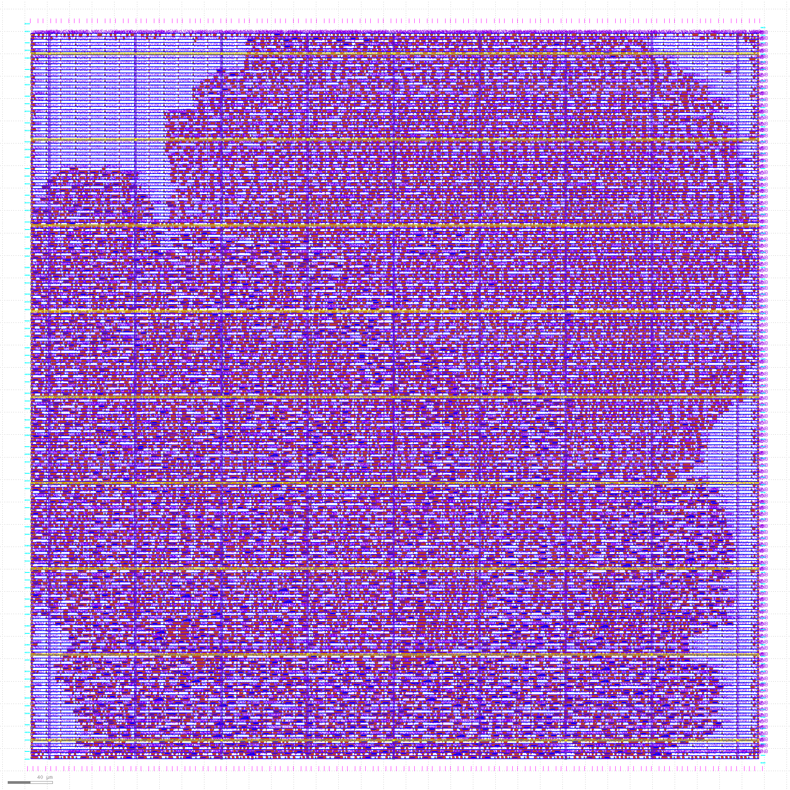
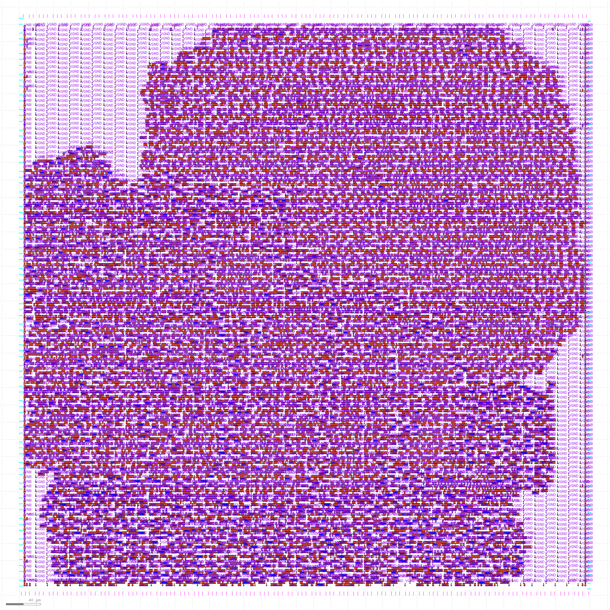
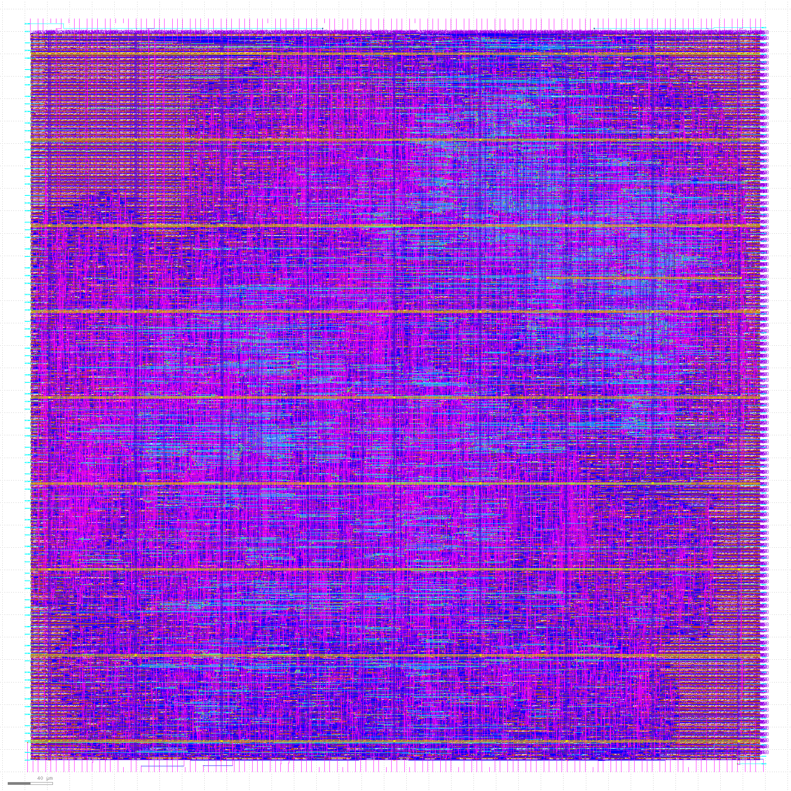

# VSD - Digital SOC Design & Planning Workshop
**OpenLANE & SkyWater 130nm PDK Physical Design Flow**

This repository documents the complete 5-day RTL-to-GDSII physical design flow using the open-source OpenLANE EDA flow, SkyWater 130nm PDK (`sky130A`), Magic, OpenSTA, and NGSPICE.

---

## Table of Contents
1. [Day 1 - Inception & OpenLANE Architecture](#day-1---inception--openlane-architecture)
2. [Day 2 - Floorplanning & Standard Cell Placement](#day-2---floorplanning--standard-cell-placement)
3. [Day 3 - Custom Cell Design, Magic Layout & DRC](#day-3---custom-cell-design-magic-layout--drc)
4. [Day 4 - Clock Tree Synthesis & Post-CTS STA](#day-4---clock-tree-synthesis--post-cts-sta)
5. [Day 5 - PDN Generation & TritonRoute Detailed Routing](#day-5---pdn-generation--tritonroute-detailed-routing)
6. [Acknowledgements & Tools Used](#acknowledgements--tools-used)

---

## Day 1 - Inception & OpenLANE Architecture

### Overview
* Explored open-source ASIC design concepts, architecture of `picorv32a` core, and the unified OpenLANE flow execution.
* Performed logic synthesis using **Yosys** and gate mapping using **ABC**.
* Calculated total cell area and flip-flop ratio from synthesis statistics.

### Key Deliverables
* `1-yosys.log` - OpenLANE synthesis execution log
* `1-yosys_pre.stat` - Technology mapping statistics and gate count breakdown

#### Calculated Flop Ratio
$$\text{Flop Ratio} = \frac{\text{Total D-Flip Flops}}{\text{Total Gate Count}}$$

---

## Day 2 - Floorplanning & Standard Cell Placement

### Overview
* Defined Core and Die dimensions, Aspect Ratio ($1.0$), and Core Utilization Factor ($0.5$).
* Configured IO pin locations, power ring/strap placement parameters, and decap cell insertion.
* Executed standard cell placement using **RePlace** (global) and **OpenDP** (detailed).

### Key Files
* `config.tcl` - OpenLANE configuration file override parameters
* `picorv32a.floorplan.def` - Design Exchange Format file after floorplan stage
* `picorv32a.placement.def` - DEF file after detailed cell placement

### Key Screenshots
#### Floorplan Die Boundary & Pin Layout (Magic)

#### Standard Cell Placement Verification

---

## Day 3 - Custom Cell Design, Magic Layout & DRC

### Overview
* Analyzed a custom standard cell inverter (`sky130_vsdinv`) in **Magic VLSI** layout editor using `sky130A.tech`.
* Performed parasitic extraction ($RC$) to SPICE netlist and ran transient simulations in **NGSPICE** to measure rise delay, fall delay, and propagation delay.
* Resolved DRC rule violations on design layers (`poly`, `met3`) and exported standard LEF (`sky130_vsdinv.lef`) for integration into OpenLANE.

### Key Files
* `sky130_vsdinv.mag` - Custom inverter layout file
* `sky130_vsdinv.spice` - Extracted parasitic SPICE netlist
* `sky130_vsdinv.lef` - Generated Library Exchange Format file
*  `sky130A.tech` - Generated Tech file

---

## Day 4 - Clock Tree Synthesis & Post-CTS STA

### Overview
* Built an optimal clock distribution tree using **TritonCTS** to ensure minimal clock skew and insertion delay across all sequential elements.
* Embedded custom inverter LEF (`sky130_vsdinv`) into the design synthesis and routing pipeline.
* Configured SDC constraints (`my_base.sdc`) and evaluated setup/hold time slacks using **OpenSTA**.

### Key Files
* `picorv32a.cts.def` - DEF file containing clock buffers and routing nets
* `10-cts.log` - OpenSTA post-CTS timing slack analysis log
* `my_base.sdc` - Synopsys Design Constraints file

### Key Screenshots
#### OpenSTA Post-CTS Tree Layout View

---

## Day 5 - PDN Generation & TritonRoute Detailed Routing

### Overview
* Generated the Power Distribution Network (PDN) grid supplying $V_{DD}$ and $V_{SS}$ power rails across all standard cell rows.
* Completed multi-layer detailed routing from Metal 1 to Metal 5 using **TritonRoute**, successfully satisfying track grid alignments, directional constraints, and DRC spacing rules.

### Key Files
* `13_pdn.def` - DEF file detailing power and ground grid structures
* `picorv32a.def` - Final routed physical design DEF file
* `14-fastRoute.log` - FastRoute iteration log for initial verification
* `17-tritonRoute.log` - TritonRoute iteration log verifying zero routing DRC violations
* `20-opensta_spef` - Extracted parasitic file for post-route analysis

### Key Screenshots
#### Magic View of Routed Design (Metal Interconnections)

---

## Acknowledgements & Tools Used

* **VSD (Virtual System for Design):** Kunal Ghosh & Team
* **SkyWater PDK:** Sky130 Open Source PDK
* **EDA Tools:** OpenLANE, Yosys, ABC, Magic VLSI, OpenSTA, TritonCTS, TritonRoute, NGSPICE, Netgen
